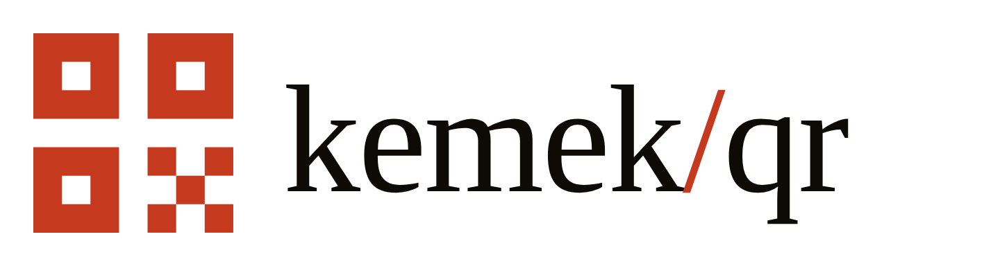
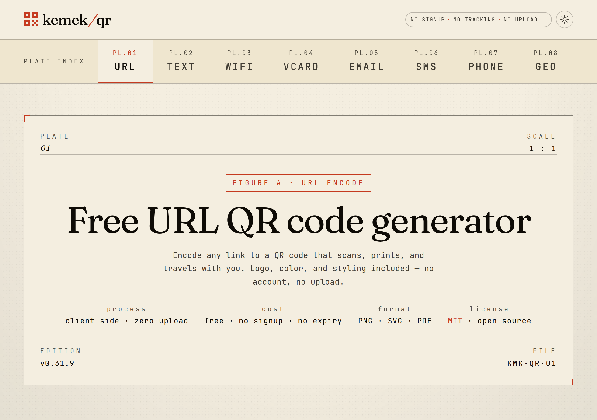
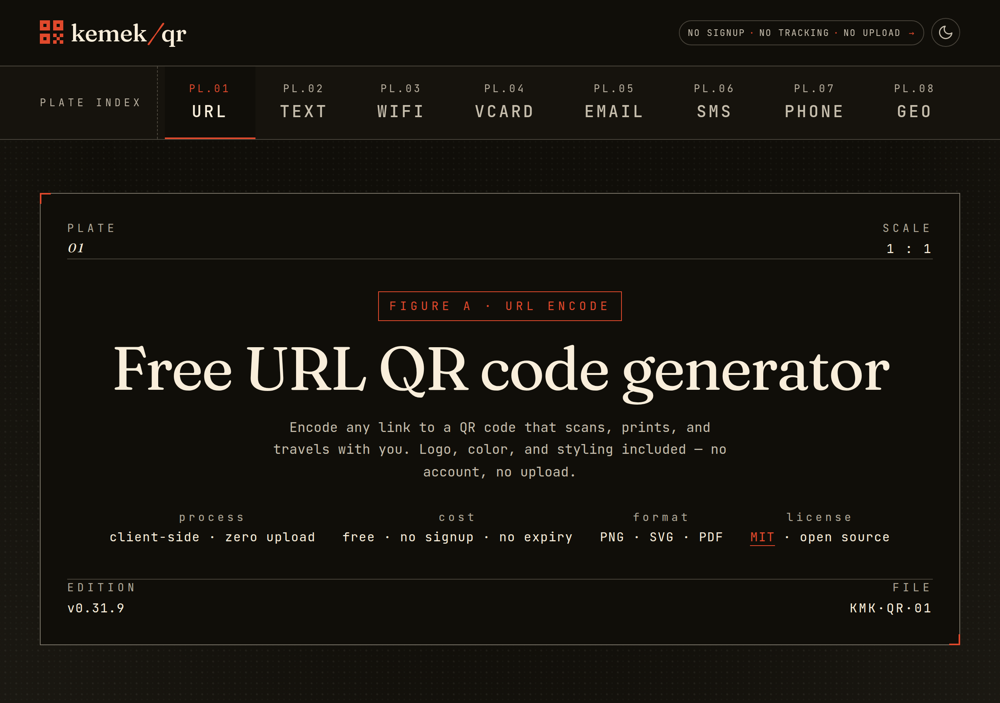
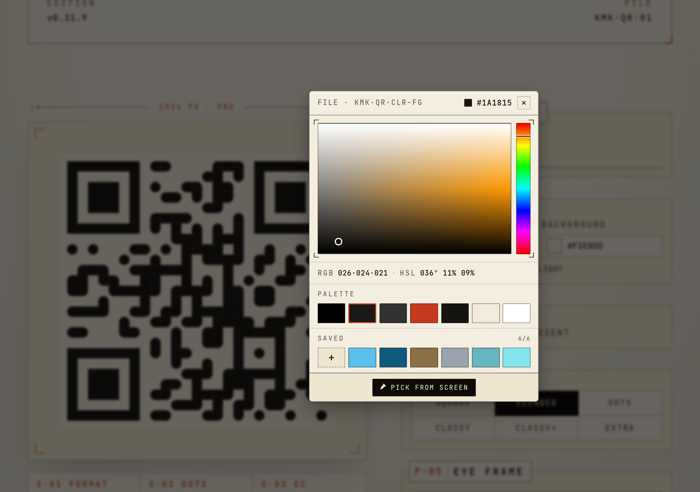
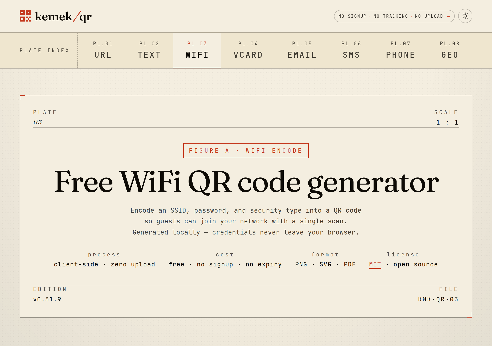

<div align="center">
  <picture>
    <source media="(prefers-color-scheme: dark)" srcset="static/brand/lockup-dark.png">
    
  </picture>

### the QR code generator that doesn't want anything from you

No signup. No tracking. No upload. Logo + styling included.
Runs in your browser — your data never leaves your machine.

[](https://qr.kemek.com)
[](LICENSE)
[](https://svelte.dev)
[](https://kit.svelte.dev)
[](https://www.typescriptlang.org)
[](#develop)
[](#performance)

[**→ open the generator**](https://qr.kemek.com) &nbsp;·&nbsp;
[the why](#why) &nbsp;·&nbsp;
[features](#features) &nbsp;·&nbsp;
[develop](#develop) &nbsp;·&nbsp;
[brand](#brand)

</div>

---

## Screenshots

<table>
  <tr>
    <td align="center" width="50%">
      
      <br /><sub><b>URL generator · light</b></sub>
    </td>
    <td align="center" width="50%">
      
      <br /><sub><b>URL generator · dark</b></sub>
    </td>
  </tr>
  <tr>
    <td align="center" width="50%">
      
      <br /><sub><b>Color picker · palette · saved · contrast readout</b></sub>
    </td>
    <td align="center" width="50%">
      
      <br /><sub><b>WiFi QR · 8 content types in total</b></sub>
    </td>
  </tr>
</table>

---

## Why

Every "free QR generator" you find on Google is one of four flavors:

| Flavor            | Tells                                                                                                         |
| ----------------- | ------------------------------------------------------------------------------------------------------------- |
| **SaaS leaders**  | Real free tier, but customization gated behind signup, dynamic QRs paywalled, your data sits on their server. |
| **Adobe / Canva** | Polished, but the QR tool is a sub-feature inside a larger workflow — not optimized for "I need a QR fast."   |
| **Privacy niche** | Right posture, weak distribution, side-project visual feel.                                                   |
| **Static legacy** | Free, no signup — and the UI is stuck in 2018.                                                                |

**kemek-qr stacks what each gets right and drops what each gets wrong.** Modern, fully free, fully featured for styling, fully client-side, with a real brand behind it. Three words, ranked:

> **free · beautiful · private**

Free is the table stakes. Beautiful is what gets it shared. Private is the moat.

---

## Features

### 8 content types

`URL` · `Text` · `WiFi` · `vCard` · `Email` · `SMS` · `Phone` · `Geo`

Each type has its own route with type-specific form fields, explainer copy targeting long-tail SEO queries, and a FAQ. The generator component is shared; the form above it is type-specific.

### Styling — all included, no paywall

- **Color** — foreground, background, optional linear gradient with custom angle.
- **Color picker** — custom drafting-spec popover with HSL pad, hue slider, EyeDropper API support, brand swatches, and a session-persistent SAVED list.
- **Contrast readout** — live WCAG ratio + verbal state (`CONTRAST 12.6:1 · DARK ON LIGHT` / `LOW` / `INVERTED`). Informational, never gates download. Catches `#FFFFFF` on `#FFFFFE`-style mistakes before you ship an unscannable code.
- **Dot shapes** — 6 variants from `qr-code-styling`.
- **Eye frame** — 4 variants. **Eye ball** — 3 variants.
- **Logo embedding** — upload PNG / JPG / WebP (up to 4 MB), sized 5–35% of the QR. Read with `FileReader` and composited locally — never uploaded.
- **Outer frame** — optional with custom label, mono or display font, S/M/L/XL size.
- **Error correction** — `AUTO` (M when plain · H when logo embedded), or manual L / M / Q / H. Each level has an inline hint explaining its recovery percentage.

### Exports

- **PNG** — 1K / 2K / 4K presets. 4K is poster-ready (300 DPI ≈ 13.6 in wide).
- **SVG** — infinite-scale vector.
- **PDF** — A4 page, embeds the framed QR as a 2048 px raster.

### Permalinks

Every styling configuration encodes into the URL hash:

```
qr.kemek.com/wifi#s=v1.eyJ0IjoidXJsIi...
```

Hash-only (never query string — the hash isn't sent over the network even in CF logs). Share the link, recipient gets your exact configuration. No URL shortener, no account, no server.

### Privacy

- **Zero outbound network requests during QR generation.** Open DevTools → Network panel → generate a QR → see nothing.
- **Logo files read locally.** `FileReader` + Canvas. Never uploaded.
- **No client-side analytics.** No Google Analytics, no Plausible, no Umami — nothing that injects a script tag and pings a server while you generate.
- **No cookies, no third-party scripts.** First-party page-view counter (KV-backed, server-side only) tracks aggregate visits to the marketing pages. Generator pages stay clean.
- **Repo is open-source MIT.** [View the source](https://github.com/KeMeK-Network/kemek-qr) and verify the claims.

---

## Performance

Lighthouse mobile audit on the live deployment (last run May 2026 at v0.31.x):

| Category       | Score   |
| -------------- | ------- |
| Performance    | **94**  |
| Accessibility  | **100** |
| Best Practices | **100** |
| SEO            | **100** |

LCP 2.74s · FCP 2.17s · CLS 0 · TBT 14ms. Dark mode tested separately and lands at the same scores with zero color-contrast audits firing.

Production bundle is ~80 KB of JS gzipped + WOFF2 font subsets preloaded for LCP. `qr-code-styling` runs on the main thread (small enough; the QR render is < 16 ms even on mid-range mobile).

---

## Stack

```
SvelteKit 2 · Svelte 5 (runes)
TypeScript (strict)
Vanilla CSS (no Tailwind, no UI framework)
qr-code-styling — encoding + styled rendering
pdf-lib — PDF export
sharp + to-ico — favicon kit build
vitest — unit tests
@sveltejs/adapter-static — fully prerendered static output
Cloudflare Pages — hosting (free tier)
```

The CSS is part of the product feel; a free utility doesn't need a framework's overhead. Drafting-spec aesthetic: cream paper, accent red, JetBrains Mono for rubrics, Fraunces for display headings.

---

## Develop

Requires Node 20+. No global tooling needed.

```sh
git clone https://github.com/KeMeK-Network/kemek-qr.git
cd kemek-qr
npm install

npm run dev          # http://localhost:5184
npm run check        # svelte-check + tsc
npm test             # vitest run
npm run format       # prettier --write
npm run build        # static output in build/
npm run preview      # local preview of production build
npm run build:images # regenerate static/*.png from SVG masters
```

Tests cover the encoders (URL / text / WiFi / vCard / email / SMS / phone / geo), the permalink wire-format round-trip, and the WCAG contrast math. UI is not unit-tested (Svelte components verified visually).

---

## Routes

| Route       | Purpose                                                            |
| ----------- | ------------------------------------------------------------------ |
| `/`         | URL generator (canonical)                                          |
| `/text`     | Plain text QR generator                                            |
| `/wifi`     | WiFi credentials QR                                                |
| `/vcard`    | Contact card (vCard 3.0)                                           |
| `/email`    | mailto: QR with optional subject + body                            |
| `/sms`      | SMS QR with optional pre-filled message                            |
| `/phone`    | tel: QR                                                            |
| `/geo`      | geo: location QR with optional label                               |
| `/about`    | Privacy stance, brand, license                                     |
| `/llms.txt` | Agent-readable site context per [llmstxt.org](https://llmstxt.org) |

Each route is independently prerendered (`@sveltejs/adapter-static`) and carries its own SEO meta + JSON-LD schema.

---

## Architecture

```
src/
├── routes/
│   ├── +layout.svelte         shared header / footer / FOUC firewall
│   ├── +layout.ts             prerender = true
│   ├── +page.svelte           URL generator (canonical /)
│   ├── +error.svelte          in-voice 404 page
│   ├── about/+page.svelte
│   ├── wifi/+page.svelte      one route per content type
│   └── ...
├── lib/
│   ├── Generator.svelte       the shared core component
│   ├── ColorPicker.svelte     custom drafting-spec modal picker
│   ├── LandingPage.svelte     per-type landing page shell
│   ├── QRAnatomy.svelte       schematic of QR functional regions
│   ├── PlateIndex.svelte      reusable cross-link list
│   ├── ExplainerSection.svelte
│   ├── encoders.ts            pure functions, type → string
│   ├── permalink.ts           v1 hash wire format + decoder
│   ├── contrast.ts            WCAG luminance + ratio math
│   └── types.ts               canonical content-type set + defaults
└── app.css                    design tokens (light + dark)

functions/                     Cloudflare Pages Functions
├── _middleware.ts             server-side pageview logger
└── api/pageviews.ts           KV-backed aggregate counter
```

Permalink format is versioned (`v1.<base64url-json>`); the decoder narrows fields with type-guard validators, so adding a new wire field is one-line additive without breaking older URLs.

---

## Roadmap

Phase 1 (v1) is **shipped and live at [qr.kemek.com](https://qr.kemek.com)**.

Post-v1 polish (no fixed date):

- **Service worker** — offline generation + install-to-home-screen.
- **Templates** — save / load named styling configurations.
- **Calendar event** — VEVENT content type for event invitations.
- **Color extraction from logo** — auto-suggest brand-matched fg/bg.
- **Themed presets** — Drafting / Blueprint / Carbon / Risograph / etc.

Considered for v2 (signal-triggered):

- **QR scanner** — privacy-respecting camera-input decoder.
- **Print sheet layout** — N copies per A4 / Letter, Avery sheet sizes.
- **Bulk generation** — paste a list, get a zip.
- **Scan-reliability checker** — simulate rotation / blur / occlusion in-browser, attempt decode.

What's permanently out: dynamic QRs, scan analytics, accounts, API tier, paid features. The brand promise is "free forever" — those would break it.

---

## Brand

The brand kit lives in [`static/brand/`](static/brand) and is shared under
the same MIT license as the code, with one carve-out:

> **The "KeMeK Network" name and the brand mark are trademarks.**
> The code is MIT — fork freely. The brand is not — your fork is your
> brand, not ours. See [`static/brand/USAGE.md`](static/brand/USAGE.md)
> for the trademark + attribution guidance.

The mark is the three QR-style finder eyes plus a quincunx of data
cells in the bottom-right quadrant. The wordmark is `kemek/qr` set in
JetBrains Mono.

---

## License

`Copyright © 2026 KeMeK Network — MIT License`

Code under [MIT](LICENSE) — fork, modify, ship, sell. Brand and
trademark carve-out under [`static/brand/USAGE.md`](static/brand/USAGE.md).

---

<div align="center">
  <sub>
    Built by <a href="https://kemek.com">KeMeK Network</a> ·
    <a href="https://qr.kemek.com">qr.kemek.com</a> ·
    <a href="https://kemek.com">kemek.com</a>
  </sub>
</div>
